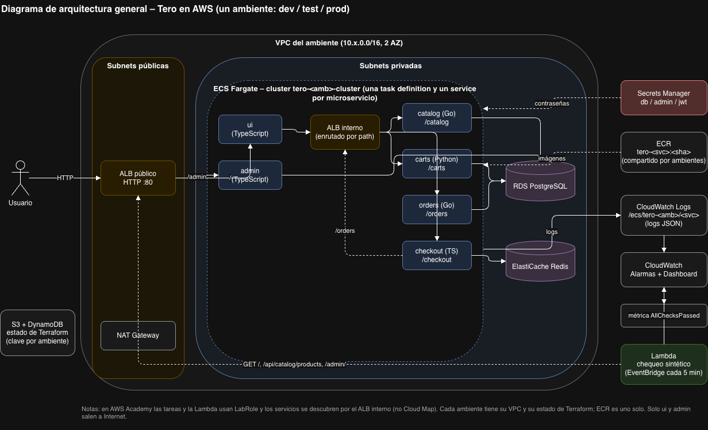
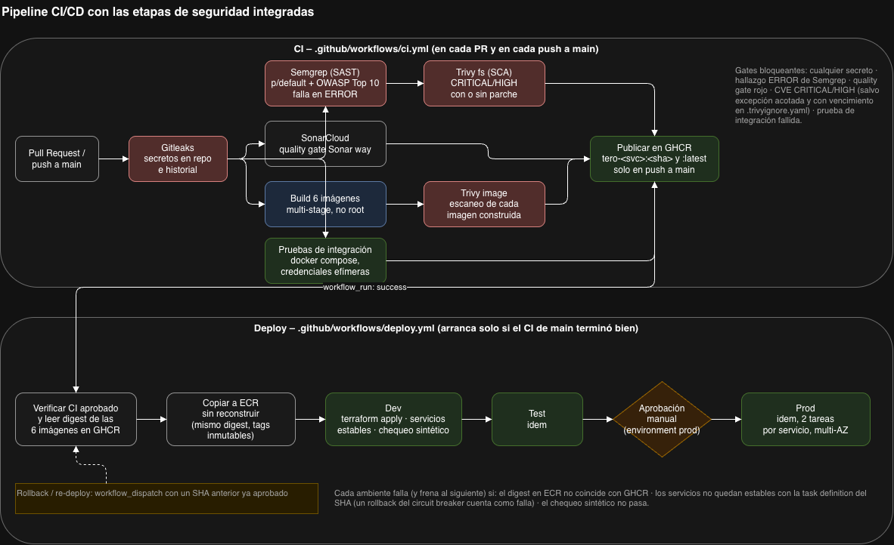
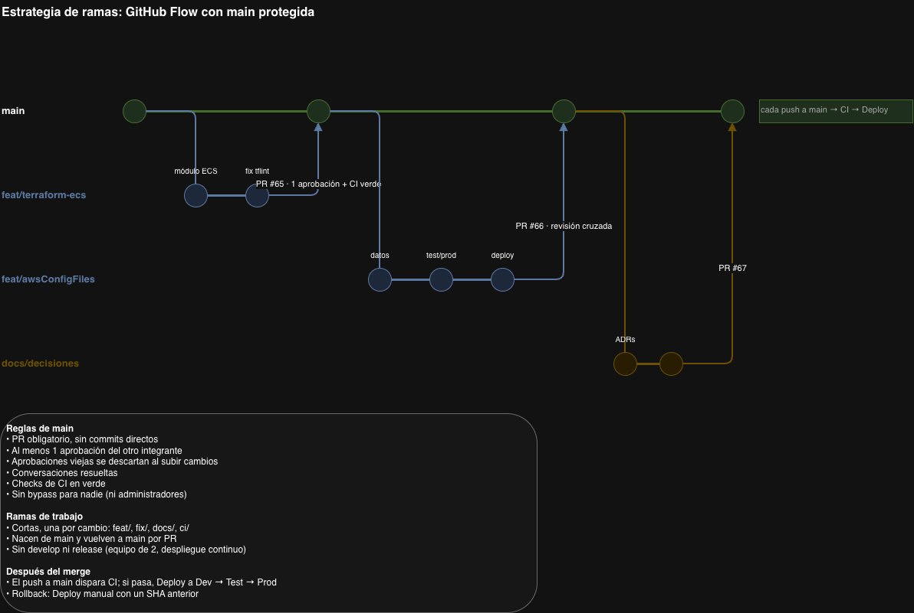

# Diagramas

Los tres diagramas del punto 9.2 de la letra. La fuente editable es `diagramas/tero-diagramas.drawio`
(una pestaña por diagrama, se abre en app.diagrams.net o con la extensión Draw.io de VS Code).

## 1. Arquitectura general

Un ambiente (dev, test o prod) es una VPC con subnets públicas (ALB, NAT) y privadas (tareas, RDS, Redis).
Solo `ui` y `admin` salen a Internet por el ALB público; el resto se llama por un ALB interno enrutado por
path (reemplaza a Cloud Map, que AWS Academy no permite). Cada ambiente tiene su estado de Terraform;
ECR es uno solo.

## 2. Pipeline CI/CD con las etapas de seguridad

CI corre en cada PR y push a main: Gitleaks → Semgrep, SonarCloud, build + Trivy image, pruebas de
integración → Trivy fs → publicación en GHCR (solo en main). Deploy arranca si el CI de main terminó bien:
copia la imagen a ECR con el mismo digest y despliega Dev → Test → (aprobación manual) → Prod.
Rollback: Deploy manual con un SHA anterior.

## 3. Estrategia de ramas

GitHub Flow: `main` protegida (PR obligatorio, 1 aprobación del otro integrante, CI verde, sin bypass) y
ramas cortas `feat/`, `fix/`, `docs/` que vuelven a main por PR. Detalle en `decisiones.md`, ADR-01.

